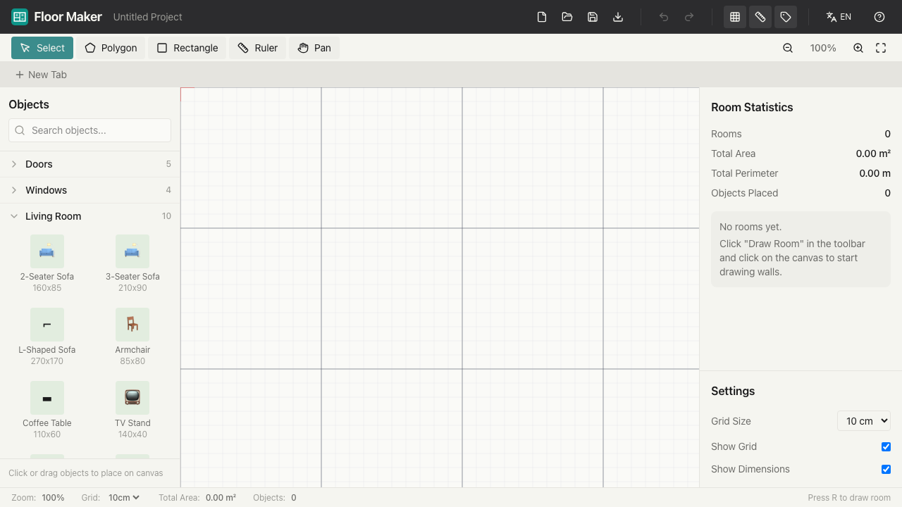

# Floor Maker

A free, browser-based 2D floor plan creator for designing room layouts and visualizing furniture placement.



## Features

- **Room Drawing** — Click-to-place walls with automatic area and perimeter calculation
- **Object Library** — 50+ pre-sized items across doors, windows, furniture, kitchen, bathroom, and more
- **Drag & Drop** — Place, move, rotate, and resize objects on an infinite canvas
- **Snap-to-Grid** — Configurable grid with metric dimensions
- **Measurements** — Auto-displayed wall lengths, room areas, and manual dimension lines
- **PDF Export** — Export floor plans to PDF for printing
- **Save / Load** — Save projects as JSON files and load them back
- **Undo / Redo** — Full history support
- **Keyboard Shortcuts** — `V` select, `R` draw room, `Space` pan, `+/-` zoom, and more
- **Multi-language** — English and Turkish

## Tech Stack

- **React 19** + **TypeScript**
- **Konva.js** (react-konva) for canvas rendering
- **Zustand** for state management
- **Tailwind CSS v4** for styling
- **Bun** + **Vite** for build tooling

## Getting Started

```bash
bun install
bun run dev
```

Open [http://localhost:5173](http://localhost:5173) in your browser.

## Scripts

| Command | Description |
|---------|-------------|
| `bun run dev` | Start development server |
| `bun run build` | Type-check and build for production |
| `bun run preview` | Preview the production build |
| `bun run lint` | Run ESLint |

## Docker

```bash
docker build -t floor-maker .
docker run -p 8080:80 floor-maker
```

## License

MIT
