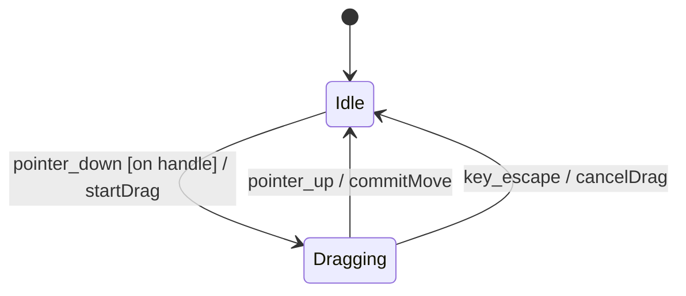

# FDD-0000: Feature title

<!--
How to use this template (delete this comment in the copy):
- Copy to docs/designs/NNNN-noun-phrase-slug.md and replace 0000 everywhere.
- Keep every heading. Under a heading that does not apply, write "N/A — <reason>".
- Aim for one to two pages. Code blocks only for interfaces, data shapes and non-obvious algorithms.
-->

## 1. Summary

<!-- One or two paragraphs: what this feature adds, which problem it solves for the homeowner or the architect hand-off, and the observable result. A reader must understand the intent from this section alone. -->

## 2. Background and current state

### 2.1 Current behaviour

<!-- How the app handles this today. Name the files and modules involved (src/...). -->

### 2.2 Problem

<!-- Why the current behaviour is not enough. -->

### 2.3 Constraints

<!-- Hard limits: integer-cm storage, logic/rendering split, older project files must still open, related ADRs. -->

## 3. Objectives and non-objectives

### 3.1 Objectives

- **OBJ-01**:

### 3.2 Non-objectives

<!-- What this feature deliberately does not do, and why. This is the guard against scope creep. -->

- **NON-01**:

## 4. User experience (guide-level)

### 4.1 Interaction flow

<!-- Step by step from the user's point of view: how it starts, the happy path, cancel (Esc), undo, and errors. Use the pt-BR labels the user sees. -->

### 4.2 Interaction states

<!-- Required when the feature adds a tool mode or a multi-step interaction; otherwise N/A. Keep under ~15 states. Label transitions as: event [guard] / action. -->



| State | Visible UI | Canvas and cursor | Shortcuts |
|---|---|---|---|
| Idle | | | |

## 5. Technical design (reference-level)

### 5.1 Components (React)

| File | Change | Responsibility |
|---|---|---|
| `src/components/...` | New / Modified / Removed | |

### 5.2 Canvas (Konva)

<!-- The layer each new shape lives in; which shapes set listening={false}; which events update Konva nodes directly during a gesture (dragmove) and which commit to the store when it ends (dragend). -->

### 5.3 State (Zustand)

<!-- Store actions added or changed, and the interfaces they use. Each user gesture commits as one undo step. -->

```ts

```

### 5.4 Domain logic

<!-- Pure functions in src/utils/: signature, units, algorithm, and what counts as invalid input. -->

### 5.5 Persistence and file format

<!-- Changes to the saved project JSON and autosave. If the shape changes, bump Project.version and describe how older files load. If nothing changes, N/A. -->

### 5.6 Edge cases

| Case | Handling |
|---|---|
| | |

## 6. Alternatives considered

<!-- Every serious option that was rejected, so it is not reopened later. -->

### 6.1 Alternative name

- **How it would work**:
- **Why rejected**:

## 7. Cross-cutting concerns

- **Undo/redo**:
- **Canvas performance**:
- **Keyboard and accessibility**:
- **Translations**: <!-- new pt-BR keys in src/i18n/translations.ts -->

## 8. Verification

### 8.1 Acceptance criteria

<!-- Given/When/Then for user interactions. Put the ID in the test name: it('[FDD-0000 / AC-01] ...') -->

- **AC-01**:
  - **Given**
  - **When**
  - **Then**

### 8.2 Invariants

<!-- Rules that must always hold, one line each. -->

- **INV-01**:

### 8.3 Test plan

| Tier | File | Covers |
|---|---|---|
| Unit (Vitest) | `src/utils/....test.ts` | AC-01, INV-01 |
| Manual (browser) | — | <!-- steps to check in npm run dev --> |

### 8.4 Definition of done

- [ ] Every AC and INV has a passing test or a recorded manual check.
- [ ] `npm run build` and `npm test` pass.
- [ ] Every new UI string exists in pt-BR.
- [ ] Older project files still open (when 5.5 changed the format).
- [ ] Lasting architectural decisions are recorded in `docs/adr/`.
- [ ] Status is Implemented and deviations are logged in 9.2.

## 9. Open questions and history

### 9.1 Open questions

- [ ] **Q1**: question — *Decision: outcome, date*

### 9.2 History and deviations

- YYYY-MM-DD: Draft created.
