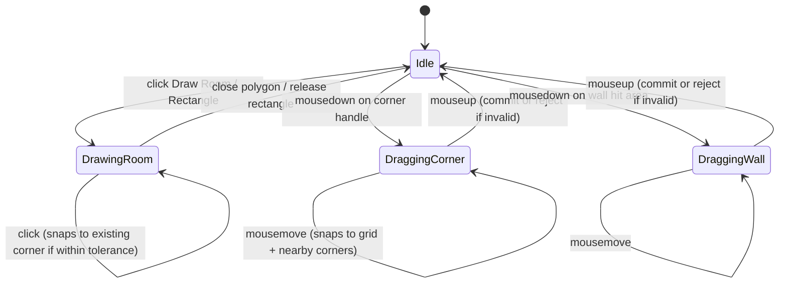

# FDD-0002: Shared walls

| Field | Value |
|---|---|
| **Status** | Implemented |
| **Owner** | Victor |
| **Created / Updated** | 2026-10-23 / 2026-10-23 |
| **Related ADRs** | ADR-0002, ADR-0003 |

## 1. Summary

When two rooms share a wall, dragging any corner or wall segment on that shared edge moves both rooms simultaneously. New rooms snap onto existing corners during drawing so adjacency is established by clicking near — not exactly on — an existing corner. This makes it possible to sketch a full floor plan where every room fits neatly against its neighbour.

## 2. Background and current state

### 2.1 Current behaviour

Each `Room` stores its own independent `Corner[]`. Two adjacent rooms drawn side by side hold two separate corners at the same coordinates — there is no link between them. Dragging a corner handle in `RoomLayer.tsx` calls `updateRoom(roomId, { corners: updatedCorners })`, which updates only that room. The neighbouring room does not move; a gap opens between them.

Room corners are snapped to the grid (`snapPointToGrid`) but not to other rooms' corners. To get coincident corners the user must click at exactly the same grid position, which is impractical when zoomed out.

### 2.2 Problem

The father will sketch a house with 6–10 rooms. Every time he adjusts one room's size the walls of adjacent rooms tear open. Without shared-wall behaviour the tool is unusable for its purpose.

### 2.3 Constraints

- Rooms stay as independent polygons (`Room.corners[]`). No DCEL (ADR-0002).
- Two corners from different rooms at identical integer centimetre coordinates are defined as *linked*. Identity check is exact integer equality — no float drift because all positions are rounded to the grid (ADR-0003).
- Linking is purely behavioural: no new field is added to `Room` or `Corner`.
- All linking and geometry logic lives in `src/utils/`; components only call store actions.

## 3. Objectives and non-objectives

### 3.1 Objectives

- **OBJ-01 — Snap on draw:** When the user clicks to place a new corner during drawing (freeform or rectangle), if the click lands within `CORNER_SNAP_TOLERANCE_CM` of any existing corner from another room, the new corner snaps to that existing corner's exact position.
- **OBJ-02 — Snap on drag:** When the user drags a corner handle to within `CORNER_SNAP_TOLERANCE_CM` of an existing corner from another room, it snaps to that position (creating a new link).
- **OBJ-03 — Linked movement:** Dragging a linked corner moves all corners from all rooms that share that position, in one store update (one undo step).
- **OBJ-04 — Wall drag:** Dragging a wall segment translates both of its endpoint corners (and all their linked counterparts) by the same delta, perpendicular to any direction the user pulls.
- **OBJ-05 — Validity guard:** A move that would collapse any affected room's area to zero or below, or create a self-intersecting polygon, is silently rejected and the corner returns to its original position.

### 3.2 Non-objectives

- **NON-01:** T-junctions (a corner coinciding with the *midpoint* of another room's wall, not its endpoint). Deferred — acceptable gap for a home sketch tool.
- **NON-02:** Mitre-joint rendering at shared corners. Walls remain simple lines.
- **NON-03:** Moving an entire room by dragging its fill. Rooms move by corner or wall drag only.
- **NON-04:** Snapping to corners of the same room (self-snap). Only corners from *other* rooms are snap candidates.

## 4. User experience (guide-level)

### 4.1 Interaction flow

**Drawing adjacent rooms:**
1. The user draws Room A (rectangle or polygon).
2. The user starts drawing Room B and clicks near a corner of Room A. A green snap indicator appears on Room A's corner. The click snaps to that exact position. Room B now shares that corner.
3. The user continues drawing Room B, clicking near other corners of Room A to share the common wall. Room B is completed flush against Room A.

**Adjusting a shared wall:**
1. The user selects either Room A or Room B.
2. They drag a corner handle on the shared wall. Both rooms resize together — no gap, no overlap.
3. They drag the wall segment itself (the line between two corners). Both endpoints move by the same delta; both rooms resize.

**Undo:** each move is one store update, so a single Ctrl+Z reverts all affected rooms (implemented in FDD-0006).

### 4.2 Interaction states



### 4.3 Snap indicator

During drawing and corner drag, when the cursor (or snapped drag position) is within `CORNER_SNAP_TOLERANCE_CM` of an existing corner, a green `<Circle>` is drawn on that corner in the canvas. It disappears when the cursor moves away. This is a Konva shape in the `InteractionLayer`; it has no hit area.

## 5. Technical design (reference-level)

### 5.1 New file: `src/utils/linking.ts`

Pure utility with no React or Konva imports. All functions take `rooms: readonly Room[]` and return new arrays/values without mutation.

```ts
/** Snap tolerance in centimetres. A dragged or placed corner within this
 *  distance of an existing corner snaps to it exactly. */
export const CORNER_SNAP_TOLERANCE_CM = 20;

/** All rooms × corners that sit at exactly the given integer position. */
export function findLinkedCorners(
  rooms: readonly Room[],
  position: Point
): { roomId: string; cornerId: string }[];

/** Returns a new rooms array with every corner at `from` translated by `delta`.
 *  Does not mutate. */
export function moveLinkedCorners(
  rooms: readonly Room[],
  from: Point,
  delta: { dx: number; dy: number }
): Room[];

/** Nearest corner from any room other than `excludeRoomId` within `tolerance`.
 *  Returns its exact position, or null if none is close enough. */
export function snapToNearestCorner(
  rooms: readonly Room[],
  point: Point,
  tolerance: number,
  excludeRoomId?: string
): Point | null;

/** True when the room has area > 0 and no self-intersecting edges. */
export function isValidRoom(room: Room): boolean;
```

`moveLinkedCorners` is called for every corner in a wall drag; the store calls it once per endpoint and merges results before committing.

### 5.2 Canvas (Konva)

**`RoomLayer.tsx` — corner drag** (modify `handleCornerDrag`):

- Change event from `onDragMove` → `onDragEnd` for the store commit. Visual snap preview uses the `Circle`'s Konva position during drag; the store is only written on `onDragEnd`. This avoids writing hundreds of undo entries per drag.
- Snap priority: (1) nearest existing corner within tolerance from another room; (2) grid snap. Whichever is closer to the raw pointer wins; if the snap-to-corner distance < grid snap distance, use the corner position.
- After computing the snapped position, call `moveCorner(roomId, cornerId, snappedPos)` in the store. The store handles linked propagation and validation.

**`RoomLayer.tsx` — wall drag** (new):

Each wall gets an invisible hit-area `<Line>` (`hitStrokeWidth={12/zoom}`, `listening={true}`, `draggable`). The visible wall line stays `listening={false}`. On `onDragEnd`, read the drag delta from Konva's position change, then call `moveWall(roomId, wallId, delta)` in the store.

**`InteractionLayer.tsx` — snap indicator** (new):

Reads `hoverSnapPoint: Point | null` from a new lightweight piece of state (a `ref` threaded down from `FloorCanvas`, not a store — it does not need persistence or undo). Renders a green `<Circle radius={8/zoom} stroke="#22c55e" fill="transparent" strokeWidth={2/zoom}>` at the snapped position when non-null.

**`FloorCanvas.tsx` — drawing clicks** (modify `handleClick`):

After computing `snappedPoint` (grid snap), run:
```ts
const cornerSnap = snapToNearestCorner(rooms, snappedPoint, CORNER_SNAP_TOLERANCE_CM);
const finalPoint = cornerSnap ?? snappedPoint;
```
Pass `finalPoint` to `addDrawingPoint` / `startDrawing` / `addRoom`. Rectangle creation (`createRoomFromRectangle`) applies the same snap to each of its four corners independently.

### 5.3 State (Zustand — `projectStore.ts`)

Add two actions:

```ts
/** Move a single corner and all corners from other rooms at the same position. */
moveCorner: (roomId: string, cornerId: string, newPosition: Point) => void;

/** Move both endpoint corners of a wall (and all their linked counterparts). */
moveWall: (roomId: string, wallId: string, delta: { dx: number; dy: number }) => void;
```

`moveCorner` logic:

```
1. Find current position of (roomId, cornerId).
2. Compute delta = newPosition − currentPosition.
3. Call moveLinkedCorners(rooms, currentPosition, delta) → candidateRooms.
4. For each room in candidateRooms that changed, call isValidRoom().
5. If all valid → set({ rooms: candidateRooms }).
6. If any invalid → no-op (corner returns to its pre-drag position).
```

`moveWall` logic:

```
1. Find start and end corners of the wall.
2. Call moveLinkedCorners twice (once per endpoint) and merge into candidateRooms.
3. Validate → commit or no-op.
```

Both actions produce a single `set()` call, which creates a single undo entry.

### 5.4 Domain logic

**Exact equality for linking** (`findLinkedCorners`):

```ts
// Integer positions guaranteed by ADR-0003 grid rounding.
position.x === corner.position.x && position.y === corner.position.y
```

No floating-point tolerance needed for the link check itself — only for the snap distance test (`snapToNearestCorner` uses `distance()` from `geometry.ts`).

**Self-intersection check** (`isValidRoom`):

For each pair of non-adjacent edges in the polygon, call `lineIntersection()` from `geometry.ts`. If any pair intersects, the room is self-intersecting. For rooms with ≤ 4 corners this is at most one pair of non-adjacent edges — fast enough.

### 5.5 Persistence

No change to the saved project JSON schema. Coincident integer positions are already stored in `Corner.position`. A project saved before FDD-0002 loads correctly; the shared-wall behaviour activates automatically for any corners that happen to share coordinates.

### 5.6 Edge cases

| Case | Handling |
|---|---|
| Corner dragged onto its own room's other corner | `snapToNearestCorner` excludes `excludeRoomId` = own room, so no self-snap |
| Move collapses a room to a line (area = 0) | `isValidRoom` returns false → move rejected |
| Room with 3 corners: valid triangle | No special case; area check is sufficient |
| Two rooms sharing a full wall (4 linked corners) | Dragging any of the 4 corners calls `moveLinkedCorners` which finds the one coincident corner from the neighbour and moves it too |
| Wall drag would make a room self-intersect | `isValidRoom` rejects → no-op |
| Drawing a room where all 4 corners snap to an existing room | Allowed; the new room sits exactly on top — this is the T-junction edge case (NON-01) |
| Undo of a linked move | One undo step reverts all rooms simultaneously (single `set()` call) |

## 6. Alternatives considered

### 6.1 DCEL (doubly-connected edge list)

Rejected in ADR-0002. Would require rewriting the entire data model and all room rendering.

### 6.2 Store a `linkedCornerIds` array on each `Corner`

Explicit links would survive position changes (the link survives even if both rooms move separately). However, maintaining them requires updating links on every room mutation. For a residential scale (< 200 corners) the O(n) scan on each drag is ~microseconds; no explicit link tracking is needed. YAGNI.

### 6.3 Snap only during drawing, not during drag

Simpler, but the father will need to reposition rooms after the initial sketch. Snap-on-drag is the primary way he creates new shared walls.

## 7. Cross-cutting concerns

- **Undo/redo:** Single `set()` per move → single undo step for all linked rooms. No change to `historyStore`.
- **Canvas performance:** `onDragMove` no longer writes to the store. Only `onDragEnd` writes. Drag rendering is pure Konva (no re-renders during drag). Net improvement over the current implementation.
- **Keyboard and accessibility:** No new keyboard shortcuts.
- **Persistence:** No schema change (see 5.5).

## 8. Verification

### 8.1 Acceptance criteria

- **AC-01:**
  - **Given** Room A exists with a corner at (200, 100)
  - **When** the user starts drawing Room B and clicks at (210, 100) — within 20 cm
  - **Then** the new corner is placed at exactly (200, 100), not (210, 100)

- **AC-02:**
  - **Given** Room A and Room B share the corner at (200, 100) — drawn using AC-01
  - **When** the user selects Room A and drags that corner to (300, 100)
  - **Then** Room B's coincident corner also moves to (300, 100); no gap exists between the rooms

- **AC-03:**
  - **Given** Room A and Room B share the wall from (200, 100) to (200, 400)
  - **When** the user drags that wall segment 50 cm to the right
  - **Then** both endpoints of Room A's wall and Room B's coincident wall endpoints move to x=250; both rooms resize correctly

- **AC-04:**
  - **Given** a corner drag that would reduce Room A's area to zero
  - **When** the drag is released
  - **Then** the corner returns to its original position and both rooms remain unchanged

- **AC-05:**
  - **Given** Room A and Room B each have unlinked corners
  - **When** the user drags Room A's corner to within 20 cm of Room B's corner and releases
  - **Then** the corner snaps to Room B's corner position and the two corners are now linked

### 8.2 Invariants

- **INV-01:** After any corner or wall drag, no two adjacent corners of the same room share the same position (no zero-length walls).
- **INV-02:** `moveCorner` and `moveWall` never produce a room with `polygonArea() === 0`.
- **INV-03:** A single linked move is exactly one store update regardless of how many rooms are affected, so it can become exactly one undo step. (Verified at store level; undo itself is not wired up, see 9.2.)

### 8.3 Test plan

| Tier | File | Covers |
|---|---|---|
| Unit (Vitest) | `src/utils/linking.test.ts` | `findLinkedCorners`, `moveLinkedCorners`, `snapToNearestCorner`, `isValidRoom` — AC-01–05, INV-01–02 |
| Unit (Vitest) | `src/stores/projectStore.test.ts` | `moveCorner` single room, `moveCorner` two linked rooms, `moveWall`, rejection of invalid move — INV-03 |
| Manual (browser) | — | Draw two adjacent rooms, drag shared corner, drag shared wall, undo — AC-01–05 |

Factory helper available: `makeRectRoom(x, y, w, h)` for concise test setup.

### 8.4 Definition of done

- [x] `src/utils/linking.ts` exists with `findLinkedCorners`, `moveLinkedCorners`, `snapToNearestCorner`, `isValidRoom`, and `CORNER_SNAP_TOLERANCE_CM`.
- [x] `projectStore` exposes `moveCorner` and `moveWall`; `updateRoom` is no longer called directly from `RoomLayer` for corner/wall drags.
- [x] Corner drag writes to the store only on `onDragEnd`, not `onDragMove`.
- [x] Wall segments are draggable.
- [x] Snap indicator appears in `InteractionLayer` during drawing and corner drag.
- [x] Snap-on-draw works for both freeform polygon and rectangle tools; snap indicator appears in both.
- [x] Invalid moves (zero area, self-intersection) are rejected silently.
- [x] `src/utils/linking.test.ts` exists and all tests pass.
- [x] `npm run build` passes with no new errors.
- [x] `npm test` passes.
- [x] Status updated to `Implemented` and deviations logged in 9.2.

## 9. Open questions and history

### 9.1 Open questions

- [x] **Q1 (Closed):** Snap indicator appears during both rectangle and freeform polygon drawing. Rectangle is the primary tool; inconsistency between tools would be confusing.
- [x] **Q2 (Closed — deferred):** Overlapping rooms are allowed silently for now. With snap-during-drawing, overlap is an edge case in normal use. A "reject if overlap" drag guard will be added in a future FDD if it proves to be a real problem in practice. The "slide to boundary" variant is out of scope for this project.

### 9.2 History and deviations

- 2026-10-23: Draft created. Q1 and Q2 resolved in review — both closed without code changes to the design.
- 2026-10-23: Approved by Victor; implemented. Verified in a real browser (Playwright driving Edge) against AC-01 to AC-05, the polygon tool and invalid-move rejection, plus 32 Vitest tests. Deviations and discoveries:
  1. **Handles and walls could not be dragged at all (pre-existing).** The stage's mouse-down handler started a selection box and cleared the selection for any press that was not on an object, including a press on a corner handle or wall, so the handles unmounted before the drag began. Present on the committed upstream code too. Fixed by naming handles and walls (`ROOM_HANDLE_NAME`, `ROOM_WALL_NAME`) and skipping the selection box for them.
  2. **Selected rooms draw last.** A neighbour's wall hit areas sat on top of the selected room's handle at a shared corner, so pressing its centre grabbed the wrong shape.
  3. **A dragged corner ignores its linked partners when snapping.** Otherwise a shared corner snapped straight back onto the corner linked to it and could not be moved less than 20 cm. `snapToNearestCorner` gained an `excludePosition` parameter.
  4. **`isValidRoom` rejects zero-length walls.** INV-01 requires it; area and self-intersection checks alone accepted a triangle with a duplicated vertex.
  5. **Wall drags snap to the grid** (not specified in this FDD), matching corner drags so walls do not drift off-grid.
  6. **Undo/redo is not wired up (pre-existing).** `historyStore.pushState` is never called and the Header's undo/redo buttons have no handlers, so the "single Ctrl+Z" expectation in 4.1 cannot be verified. Out of scope here; needs its own FDD.
- 2026-10-23: Item 6 resolved by FDD-0006: undo/redo now exists and a linked move undoes in one step (FDD-0006 AC-03).
