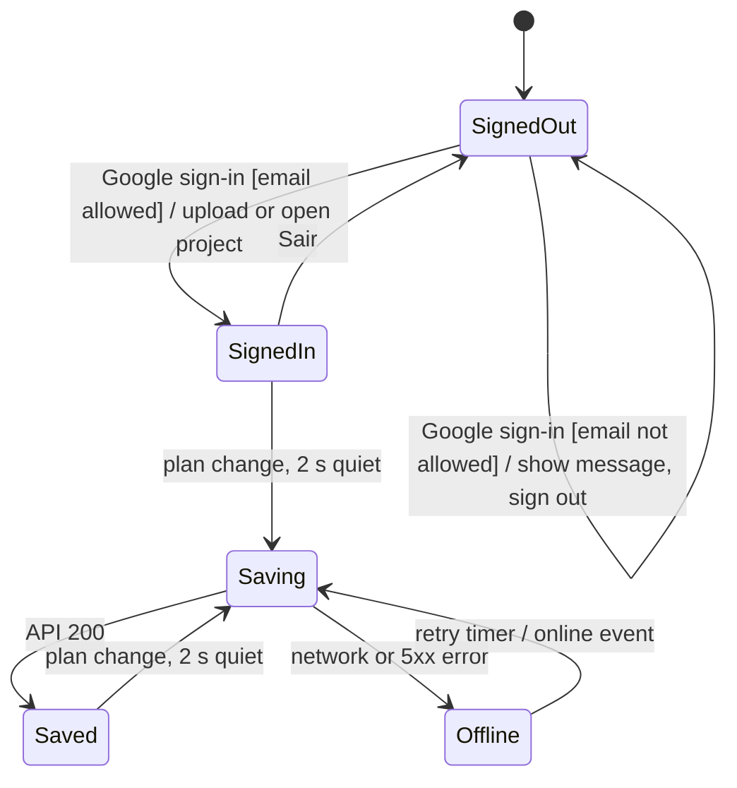

# FDD-0008: Cloud projects

| Field | Value |
|---|---|
| **Status** | In Progress |
| **Owner** | Victor |
| **Created / Updated** | 2026-10-23 / 2026-10-23 |
| **Related ADRs** | ADR-0004 |

## 1. Summary

Save projects to the cloud automatically. The user signs in once with their Google account; from then on every change is saved to a Neon Postgres database a few seconds after they make it, and the header shows *Salvo na nuvem*. They can open any of their projects from any computer through a *Meus projetos* list. Only email addresses on an allow-list can sign in at all. The browser copy and the JSON download keep working as backups.

## 2. Background and current state

### 2.1 Current behaviour

Projects live in the browser (`persist` in `projectStore` and `tabsStore`) and can be downloaded and opened as version 1.1 JSON files (FDD-0007, `src/utils/projectFile.ts`). There is no server, no login and no notion of "my projects".

### 2.2 Problem

Clearing browser data or changing computers loses the plan, and the JSON download depends on the user remembering it (ADR-0004).

### 2.3 Constraints

- The browser never sees database credentials; every database call goes through our API, which verifies the user first (ADR-0004).
- The stored format is the existing version 1.1 project JSON, validated with `parseProjectFile` on the server as well as in the browser.
- Free plans: Neon Free, Vercel Hobby.
- The app must keep working without a connection, falling back to the browser copy.

## 3. Objectives and non-objectives

### 3.1 Objectives

- **OBJ-01:** *Entrar com Google* signs the user in; *Sair* signs out. Without signing in, the app works exactly as today (browser only).
- **OBJ-02:** Only emails listed in the server's `ALLOWED_EMAILS` can use the API; anyone else sees *Este e-mail não tem acesso.*
- **OBJ-03:** While signed in, changes to the plan, options or project name are saved to the cloud 2 seconds after the last change.
- **OBJ-04:** The header shows the save state: *Salvando…*, *Salvo na nuvem*, or *Não salvo — sem conexão* (retried automatically).
- **OBJ-05:** *Meus projetos* lists the cloud projects (name and last change) and opens one; *Novo projeto* creates a new cloud project.
- **OBJ-06:** On the first sign-in, the project already in the browser is uploaded as the first cloud project, so nothing is lost. An empty plan is not uploaded.
- **OBJ-07:** Every allowed person sees every project (one family, one house).

### 3.2 Non-objectives

- **NON-01:** Real-time collaboration or merging. If two computers edit the same project at once, the last save wins.
- **NON-02:** Sharing with people outside the allow-list (for example the architect). They receive the PDF or JSON.
- **NON-03:** Cloud version history. Undo (FDD-0006) and JSON downloads cover recovery.
- **NON-04:** Email/password login (Victor chose Google).
- **NON-05:** Managing the allow-list from the UI. It is an environment variable.

## 4. User experience (guide-level)

### 4.1 Interaction flow

1. The user opens the site. The header has *Entrar com Google*.
2. He clicks it, picks his Google account and returns to the app. His current plan is uploaded as his first cloud project.
3. He keeps drawing. The header briefly shows *Salvando…*, then *Salvo na nuvem*.
4. On another computer he signs in, opens *Meus projetos* and clicks his project. It loads with all its options.
5. If the internet drops, the header shows *Não salvo — sem conexão*; the plan stays in the browser and is sent when the connection returns.
6. Someone not on the list who signs in sees *Este e-mail não tem acesso.* in the header and is signed out.
7. *Novo projeto* or opening a JSON file while signed in starts a separate cloud project on the next save; it never overwrites the project that was open.

### 4.2 Interaction states



| State | Visible UI |
|---|---|
| SignedOut | *Entrar com Google* button; app saves to the browser only |
| Saving | *Salvando…* |
| Saved | *Salvo na nuvem* |
| Offline | *Não salvo — sem conexão* in amber |
| Denied | *Este e-mail não tem acesso.* in red, with *Entrar com Google* |

## 5. Technical design (reference-level)

### 5.1 Components (React)

| File | Change | Responsibility |
|---|---|---|
| `src/components/layout/Header.tsx` | Modified | Sign-in/out button, save status, *Meus projetos*. *Novo projeto* creates a cloud project when signed in. |
| `src/components/layout/ProjectsDialog.tsx` | New | List and open cloud projects. |
| `src/i18n/translations.ts` | Modified | All new strings. |

### 5.2 Canvas (Konva)

N/A.

### 5.3 State (Zustand)

`src/stores/cloudStore.ts`: `email`, `projectId`, `dirty`, `status` (`idle | saving | saved | offline | denied`). `projectId` and `dirty` are persisted in the browser.

`src/stores/cloudSync.ts` subscribes to `projectStore` and `tabsStore` (the same pattern as FDD-0006). Any change sets `dirty` and schedules a save 2 s later, which sends `serializeProject(...)` to the API. `dirty` tells a reload which copy is newer: unsent browser changes are uploaded, otherwise the cloud copy is loaded, since another computer may have changed it. Loading a cloud project does not set `dirty`.

### 5.4 Domain logic

**Browser auth** (`src/lib/auth.ts`): `createAuthClient(import.meta.env.VITE_NEON_AUTH_URL)` from `@neondatabase/auth` (default vanilla adapter; state lives in Zustand). Sign-in: `signIn.social({ provider: 'google', callbackURL })`. API calls send `Authorization: Bearer <jwt>`, read from `getSession().data.session.token`, where Neon's adapter places the signed JWT (the same source as its `getJWTToken`, which the public client type does not expose).

**API** (`api/` at the repository root, deployed by Vercel as serverless functions):

| Method and path | Action |
|---|---|
| `GET /api/projects` | List `{ id, name, updatedAt }` |
| `POST /api/projects` | Create from a project file; returns `{ id }` |
| `GET /api/projects/:id` | Return `{ id, name, data, updatedAt }` |
| `PUT /api/projects/:id` | Replace `name` and `data` |

Every handler starts with the same guard:

```
1. Read the Bearer token; verify it against NEON_AUTH_JWKS_URL (jose: createRemoteJWKSet + jwtVerify) → 401.
2. Reject unless the token's email is verified and in ALLOWED_EMAILS → 403.
3. For bodies: size ≤ 1 MB, then parseProjectFile (the same validator as file opening) → 400 if invalid.
4. Only then query the database (@neondatabase/serverless, DATABASE_URL).
```

**Database** (one table, created by `db/schema.sql`):

```sql
create table projects (
  id          uuid primary key default gen_random_uuid(),
  name        text not null,
  data        jsonb not null,          -- version 1.1 project file (FDD-0007)
  created_by  text not null,           -- email of the creator
  updated_at  timestamptz not null default now()
);
```

### 5.5 Persistence

- **Cloud:** the `projects` table above. The stored JSON is the same version 1.1 format as downloads; no migration of existing files is needed.
- **Browser:** unchanged; it remains the offline copy and the source for the first upload (OBJ-06).
- **Secrets** (in `.env.local`, which `.gitignore` already excludes, and in Vercel's settings): `DATABASE_URL`, `NEON_AUTH_JWKS_URL`, `ALLOWED_EMAILS` (server only) and `VITE_NEON_AUTH_URL` (browser, not secret).

### 5.6 Edge cases

| Case | Handling |
|---|---|
| Not signed in | Browser-only, exactly as today |
| Token expired | The auth client renews it before each call; a 401 means the session is gone, so the app shows *Entrar com Google* |
| Email not allowed (403) | Status *Este e-mail não tem acesso.*; the app signs out |
| Allowed email registered with a password but never verified | 403; Neon Auth allows unverified email sign-up, so only verified emails pass |
| Save fails (offline or 5xx) | Status *Não salvo*; retry every 15 s and on the browser's `online` event; browser copy kept |
| Change made during a save | Saved again 2 s later |
| *Novo projeto* or opening a file while signed in | The next save creates a new cloud project |
| Reload with unsent changes | The browser copy is uploaded; otherwise the cloud copy is loaded |
| Project deleted elsewhere | `PUT` returns 404; the app creates it again from the browser copy |
| Same project open on two computers | Last save wins (NON-01) |
| Body larger than 1 MB | 413; a plan for one house is a few tens of kB |
| Malformed body | 400 from `parseProjectFile`; never stored |

## 6. Alternatives considered

See ADR-0004: browser only, Google Drive, the Neon Data API with row-level security, Supabase or Firebase. Also considered here:

### 6.1 Neon Functions instead of Vercel functions

Neon's recommended backend layer, but it adds a second deployment and is offered only in some regions. Vercel functions deploy with the site we already host there.

### 6.2 Projects owned per user

More private, but users would need a sharing feature to work on the same project. An allow-list where everyone sees everything fits a small group (OBJ-07).

## 7. Cross-cutting concerns

- **Security:** no database credentials in the browser; every request verified; input validated with the shared parser; allow-list on the server; secrets never committed.
- **New dependencies (to approve):** `@neondatabase/auth` (browser login), `@neondatabase/serverless` (database driver in the API), `jose` (token verification).
- **Undo/redo:** unaffected; cloud saves are a side effect of plan changes.
- **Cost:** Neon Free and Vercel Hobby; one family's usage is far below their limits.
- **Privacy:** the plan of the house and the family's emails are stored at Neon (USA or the nearest offered region).

## 8. Verification

### 8.1 Acceptance criteria

- **AC-01:**
  - **Given** an allowed Google account
  - **When** the user signs in on a browser that already has a plan
  - **Then** that plan becomes a cloud project and the header shows *Salvo na nuvem*
- **AC-02:**
  - **Given** a signed-in user
  - **When** they move a wall and wait 2 seconds
  - **Then** the cloud copy contains the change
- **AC-03:**
  - **Given** the same account on a second browser with empty storage
  - **When** they open the project from *Meus projetos*
  - **Then** every option, the lot and the targets are there
- **AC-04:**
  - **Given** a Google account not on the allow-list
  - **When** it signs in
  - **Then** the app shows *Este e-mail não tem acesso.*, and the API answers 403 to every call
- **AC-05:**
  - **Given** no token or an invalid token
  - **When** any API route is called
  - **Then** it answers 401 and touches no data
- **AC-06:**
  - **Given** a signed-in user who goes offline and keeps drawing
  - **When** the connection returns
  - **Then** the pending change is saved without user action

### 8.2 Invariants

- **INV-01:** No database query runs before the token and the allow-list check pass.
- **INV-02:** Every stored `data` value passes `parseProjectFile`.
- **INV-03:** No secret is present in the browser bundle (`DATABASE_URL`, `ALLOWED_EMAILS`).

### 8.3 Test plan

| Tier | File | Covers |
|---|---|---|
| Unit (Vitest) | `api/_lib/guard.test.ts` | Token, allow-list and body checks with a fake JWKS — AC-04, AC-05, INV-01, INV-02 |
| Unit (Vitest) | `src/stores/cloudSync.test.ts` | Debounce, status transitions, retry — AC-02, AC-06 |
| Browser (automated, mocked session and API) | Playwright script, not committed | Header states, autosave, *Meus projetos*, opening without saving back |
| Browser (manual, Victor) | — | Real Google sign-in and CRUD round trip on the production site — AC-01, AC-03, AC-04 |
| Build check | `dist/` grep | INV-03 |

Real Google sign-in cannot run in the automated browser, so AC-01, AC-03 and AC-04 are checked by Victor on the production site. Preview deployments are not used: their addresses are not on Neon's trusted-domain list, so sign-in would be blocked there.

### 8.4 Definition of done

- [x] Neon project, Neon Auth with Google, `projects` table and Vercel environment variables set up (Victor, with step-by-step instructions).
- [x] API with the shared guard, and its tests.
- [x] Sign-in/out, autosave with status, *Meus projetos*, first-upload migration.
- [x] Offline fallback and retry.
- [x] README (setup and new env vars), CLAUDE.md ("No backend" replaced) and ADR-0004 status updated.
- [x] `npm run build` and `npm test` pass; no secret in `dist/`.
- [ ] Real Google sign-in verified on the production site (AC-01, AC-03, AC-04).
- [ ] Status updated to `Implemented` and deviations logged in 9.2.

## 9. Open questions and history

### 9.1 Open questions

- [x] **Q1:** Site deployed at `https://blueprint-os-sigma.vercel.app/` (Vercel, victorssantoss-projects). API functions deploy there automatically.
- [x] **Q2:** Allow-list: Victor's email for now; a second email to be added once decided. The list lives only in `ALLOWED_EMAILS`, never in the repository.
- [x] **Q3:** Region: `sa-east-1` (São Paulo) — already chosen when the Neon project was created.
- [x] **Q4:** Three new dependencies approved: `@neondatabase/auth`, `@neondatabase/serverless`, `jose`.

### 9.2 History and deviations

- 2026-10-23: Draft created. Google sign-in configuration steps and Neon Auth's table names are not in Neon's published guide; they are confirmed during setup.
- 2026-10-23: Moved to In Review. Q1–Q4 closed: Vercel domain confirmed, allow-list seeded, region confirmed, dependencies approved. Google OAuth staying on Neon Shared keys (appropriate for a personal family project). Neon Trusted Domains list: `https://blueprint-os-sigma.vercel.app/` added by Victor.
- 2026-10-23: Approved; implementation started. ADR-0004 Accepted.
- 2026-10-23: Implemented, pending the real sign-in check on the production site. Deviations from the draft:
  - **Verified email required.** Neon Auth has email/password sign-up on with *Verify at Sign-up* off, so anyone could register an allowed address without owning it. The guard rejects tokens whose `emailVerified` is not `true`; Google accounts always pass.
  - **No `DELETE` route.** No objective needs deleting from the app; unused projects can be removed in the Neon console.
  - **No retry after a 401.** The auth client renews the token itself, so a 401 means the session ended.
  - **Fixed 15 s retry** plus the `online` event instead of back-off; one family's traffic does not need it.
  - **`dirty` flag instead of `lastSavedAt`**, persisted, to decide at startup whether the browser or the cloud copy is newer (§5.3). Without it, a second computer would overwrite newer cloud changes with its stale browser copy.
  - **Detach on *Novo projeto* and file open**, so a new or opened project never overwrites the cloud project that was open.
  - **"No access" shown in the header** (status `denied`) rather than as a toast, so it stays visible.
  - **Default vanilla auth adapter** instead of the React adapter; sign-in state lives in `cloudStore`. The JWT is read from the session (§5.4).
  - **`api/` imports shared code with `.js` extensions** (`src/utils/projectFile.ts` → `./lot.js`), which Vite, TypeScript and Node's ES module loader all resolve.
  - **Google stays on Neon's shared keys.** The OAuth redirect goes through Neon's shared callback, so no Google Cloud project is needed.
- 2026-10-24: Deployed. Verified on the production site: Google sign-in, autosave with *Salvo na nuvem* (AC-01, AC-02), and *Este e-mail não tem acesso.* for an account not on the list (AC-04). The token is read from the session as designed; no change was needed.
- 2026-10-24: Two fixes after the first real use. The header showed *Salvo na nuvem* during the 2 s before a change was sent; it now shows *Salvando…* from the moment of the change. Opening a project (cloud, file or *Novo projeto*) now fits the view to the whole plan, lot included (`fitViewToPlan` in `stores/tabs.ts`); switching between options keeps the view so they stay easy to compare.
